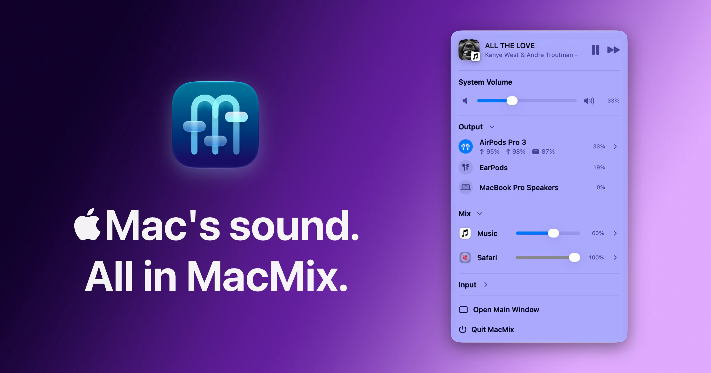

<p align="center">
  
</p>

<p align="center">
  <a href="https://github.com/ljmng7/MacMix/releases/latest"></a>
  <a href="https://github.com/ljmng7/MacMix/stargazers"></a>
  <a href="https://github.com/ljmng7/MacMix/releases"></a>
  
  
  <a href="../../LICENSE"></a>
</p>

<p align="center">
  <a href="https://trendshift.io/repositories/197969?utm_source=trendshift-badge&amp;utm_medium=badge&amp;utm_campaign=badge-trendshift-197969" target="_blank" rel="noopener noreferrer"></a>
</p>

<p align="center">
  <a href="../../README.md">English</a> · <a href="README.zh-Hans.md">简体中文</a> · <a href="README.zh-Hant.md">繁體中文</a> · <a href="README.ja.md">日本語</a> · <a href="README.ko.md">한국어</a> · <a href="README.fr.md">Français</a> · <a href="README.de.md">Deutsch</a> · <a href="README.es.md">Español</a> · <a href="README.it.md">Italiano</a> · <b>Português (Brasil)</b> · <a href="README.ru.md">Русский</a> · <a href="README.ar.md">العربية</a> · <a href="README.hi.md">हिन्दी</a> · <a href="README.id.md">Bahasa Indonesia</a> · <a href="README.th.md">ไทย</a> · <a href="README.vi.md">Tiếng Việt</a> · <a href="README.tr.md">Türkçe</a> · <a href="README.nl.md">Nederlands</a> · <a href="README.pl.md">Polski</a>
</p>

<p align="center">
  <a href="https://github.com/ljmng7/MacMix/releases/latest/download/MacMix.dmg">
    
  </a>
</p>

<p align="center">
  <a href="#recursos">Recursos</a> ·
  <a href="#código-aberto-e-distribution">Código aberto vs. Distribution</a> ·
  <a href="#instalação">Instalação</a> ·
  <a href="#privacidade">Privacidade</a> ·
  <a href="#compilar-a-partir-do-código">Compilar a partir do código</a> ·
  <a href="#apoie-o-macmix">Apoiar</a> ·
  <a href="#licença-e-marca">Licença</a>
</p>

---

## Por que o MacMix

O macOS oferece um único controle de volume. O MacMix oferece o resto: abaixe um app barulhento sem mexer na música, alterne entre AirPods, alto-falantes e monitor com um clique e escolha o microfone certo antes de uma chamada. Tudo em um painel nativo e compacto na barra de menus, sem abrir os Ajustes do Sistema.

## Recursos

### 🔊 Volume

- **Volume do sistema** do dispositivo de saída atual, direto na barra de menus.
- **Alto-falantes de monitores externos** via DDC/CI quando o macOS não oferece controle de volume, com correções para monitores que informam faixas incomuns.
- **Zero de verdade**: ao levar um controle a 0%, o dispositivo fica totalmente mudo, sem volume residual.

### 🎧 Dispositivos

- **Troque a saída** entre alto-falantes, fones, AirPods, monitores e mais.
- **Receptores AirPlay pelo nome**: cada HomePod ou alto-falante AirPlay ganha sua própria linha, e você pode passar de um grupo ativo para um único receptor.
- **Ícones reconhecíveis** para AirPods, Beats, HomePod, Apple TV, monitores externos e os alto-falantes do seu Mac, além do ícone fornecido pelo próprio dispositivo.
- **Troque o microfone** e ajuste o volume de entrada no mesmo painel.

### 🎚️ Mixagem por app

- **Abaixe qualquer app** enquanto ele toca, ou aumente até **200%** (opcional, nos Ajustes).
- **Lembra seus níveis** e os restaura quando o app volta a tocar.
- **Encontra o app real** por trás da reprodução na web, incluindo apps de iPad que reproduzem mídia via WebKit.

### 🍃 Leve por natureza

- Fica discreto na barra de menus, com uma janela de ajustes opcional.
- SwiftUI nativo, áudio processado localmente em tempo real, sem conta.
- O app oficial se atualiza sozinho com o Sparkle.

## Código aberto e Distribution

**Todos os recursos do MacMix são de código aberto, incluindo o MacMix Studio.** Compile este repositório você mesmo e você terá o app completo com todos os recursos desbloqueados: sem licença, sem conta, sem nada guardado.

O download da página Releases é o **Distribution**: a versão oficial do mesmo app. Ele é gratuito, e o **MacMix Studio** é uma compra opcional e única que desbloqueia os recursos do Studio nessa versão. Não existe um “app Studio” separado: a licença desbloqueia recursos no mesmo app, e seus ajustes continuam onde estão.

| Recursos incluídos | <div align="center">Compilado do código-fonte<br><sub>(este repositório)</sub><br><sub>&nbsp;&nbsp;&nbsp;&nbsp;&nbsp;&nbsp;&nbsp;&nbsp;&nbsp;&nbsp;&nbsp;&nbsp;&nbsp;&nbsp;&nbsp;&nbsp;&nbsp;&nbsp;&nbsp;&nbsp;&nbsp;&nbsp;&nbsp;&nbsp;&nbsp;&nbsp;&nbsp;&nbsp;&nbsp;&nbsp;&nbsp;&nbsp;&nbsp;&nbsp;&nbsp;</sub></div> | <div align="center">Distribution<br><sub>(gratuita)</sub><br><sub>&nbsp;&nbsp;&nbsp;&nbsp;&nbsp;&nbsp;&nbsp;&nbsp;&nbsp;&nbsp;&nbsp;&nbsp;&nbsp;&nbsp;&nbsp;&nbsp;&nbsp;&nbsp;&nbsp;&nbsp;&nbsp;&nbsp;&nbsp;&nbsp;&nbsp;&nbsp;&nbsp;&nbsp;&nbsp;&nbsp;&nbsp;&nbsp;&nbsp;&nbsp;&nbsp;</sub></div> | <div align="center">Distribution<br><sub>(Studio)</sub><br><sub>&nbsp;&nbsp;&nbsp;&nbsp;&nbsp;&nbsp;&nbsp;&nbsp;&nbsp;&nbsp;&nbsp;&nbsp;&nbsp;&nbsp;&nbsp;&nbsp;&nbsp;&nbsp;&nbsp;&nbsp;&nbsp;&nbsp;&nbsp;&nbsp;&nbsp;&nbsp;&nbsp;&nbsp;&nbsp;&nbsp;&nbsp;&nbsp;&nbsp;&nbsp;&nbsp;</sub></div> |
| --- | :---: | :---: | :---: |
| Volume do sistema, do monitor e por app | ✅ | ✅ | ✅ |
| Troca de dispositivos de saída, AirPlay e entrada | ✅ | ✅ | ✅ |
| Amplificação de 200% por app | ✅ | ✅ | ✅ |
| Envio de feedback com registros de diagnóstico anônimos | ✅ | ✅ | ✅ |
| **EQ personalizado** — ajuste o som de cada app e salve seus presets | ✅ | — | ✅ |
| **Saída para vários dispositivos** — um app em vários dispositivos ao mesmo tempo, cada um com seu próprio volume | ✅ | — | ✅ |
| **Controles Pro** — bateria de dispositivos Bluetooth, Modo de Audição e Áudio Espacial | ✅ | — | ✅ |
| **Reproduzindo agora** — veja e controle a mídia atual | ✅ | — | ✅ |
| **Predefinições de cena** — salve dispositivos e volumes dos apps e alterne com um clique | ✅ | — | ✅ |
| **Controles de Volume do Sistema** — assuma as teclas de volume para um ajuste mais suave | ✅ | — | ✅ |
| **Bloquear dispositivo de entrada** — impeça o macOS de trocar seu microfone | ✅ | — | ✅ |
| **Lista de bloqueio** — deixe apps específicos fora da mixagem | ✅ | — | ✅ |
| **Personalização** — temas personalizados | ✅ | — | ✅ |
| Assinada e autenticada pelo desenvolvedor | — | ✅ | ✅ |
| Atualizações automáticas | — | ✅ | ✅ |
| **Acesso antecipado às betas** — experimente as novidades primeiro | — | — | ✅ |

> [!NOTE]
> Só as partes que existem exclusivamente para o Distribution continuam privadas: ativação de licença, fluxo de compra, apresentação inicial e atualizador. Nenhuma delas é necessária para compilar ou executar o MacMix, e as versões compiladas deste repositório não incluem nenhuma delas.

## Instalação

1. Baixe [`MacMix.dmg`](https://github.com/ljmng7/MacMix/releases/latest/download/MacMix.dmg) da versão mais recente.
2. Abra a imagem de disco e arraste o **MacMix** para **Aplicativos**.
3. Abra o MacMix e clique no ícone dele na barra de menus.

**Requisitos:** macOS Sonoma 14.4 ou posterior. A mixagem por app pede a permissão **Gravação de Áudio do Sistema** no primeiro uso; o resto funciona sem ela.

## Privacidade

O MacMix processa o áudio **localmente no seu Mac**. Ele nunca grava, salva ou envia áudio.

A mixagem por app usa os taps de processos de áudio do macOS; por isso o macOS pede a permissão Gravação de Áudio do Sistema antes que o MacMix possa alterar o volume de outro app. O MacMix usa essa permissão apenas para a mixagem local em tempo real.

## Compilar a partir do código

```sh
git clone https://github.com/ljmng7/MacMix.git
cd MacMix
open MacMix.xcodeproj
```

Selecione o esquema **MacMix** e clique em **Run**. O Xcode resolve automaticamente os pacotes Swift (MenuBarExtraAccess e Swift Atomics). Todos os recursos do Studio vêm desbloqueados na sua versão.

Sem uma equipe de desenvolvimento, o Xcode assina o app apenas para execução local, e o macOS pode pedir de novo a permissão de **Gravação de Áudio do Sistema** a cada nova compilação. Para manter a permissão, copie `Config/Local.example.xcconfig` para `Config/Local.xcconfig` e defina o seu próprio `DEVELOPMENT_TEAM`. O Git ignora esse arquivo.

Versões compiladas do código-fonte não se atualizam sozinhas. Para atualizar, baixe o código mais recente e compile de novo.

Os testes de regressão são scripts simples que só precisam das ferramentas de linha de comando do Xcode:

```sh
for test in tests/run-*.sh; do bash "$test"; done
```

<details>
<summary><strong>Observações e limitações</strong></summary>

<br>

- Os apps aparecem no mixer apenas enquanto o macOS informa que estão reproduzindo áudio.
- Os níveis por app ficam salvos localmente e são restaurados quando o mesmo app volta a tocar.
- O volume do monitor exige uma tela compatível com volume de alto-falantes DDC/CI (VCP `0x62`) pelo cabo ou dock em uso. Adaptadores DisplayLink, algumas conexões HDMI, TVs e telas com DDC/CI desativado no menu OSD podem não oferecer esse controle.
- Os nomes dos receptores AirPlay vêm das fontes de dados do dispositivo AirPlay. Quando o macOS não informa o nome, o MacMix mostra o dispositivo AirPlay genérico em vez de adivinhar.

</details>

## Apoie o MacMix

Compilar do código-fonte é, e continuará sendo, gratuito. Se o MacMix faz parte do seu dia, considere comprar o **MacMix Studio**: uma compra única que desbloqueia os recursos do Studio no Distribution — o app assinado, notarizado e que se mantém atualizado sozinho — e financia diretamente o desenvolvimento do MacMix.

<p align="center">
  <a href="https://checkout.dodopayments.com/buy/pdt_0NmJ2vOqulR07tfZqwKtU?quantity=1"></a>
</p>

Relatos de bugs e ideias são bem-vindos em [Issues](https://github.com/ljmng7/MacMix/issues). Para contribuir com código, veja o [guia de contribuição](../../CONTRIBUTING.md); pull requests exigem a assinatura de um Contrato de Licença de Colaborador (CLA).

## Licença e marca

O MacMix é software livre: você pode redistribuí-lo e/ou modificá-lo nos termos da [Licença Pública Geral GNU, versão 3](../../LICENSE) (GPL-3.0). As versões até a 2.3.2, inclusive, foram lançadas sob a Licença MIT; o código que você recebeu sob esses termos continua disponível sob eles.

**Marca.** O nome “MacMix” e o ícone do app MacMix identificam o app oficial e são reservados às versões oficiais. A GPL cobre o código, não o nome nem a marca. Se você distribuir um fork ou uma versão modificada, dê a ela outro nome, outro ícone e outro identificador de pacote, e não a apresente como o MacMix oficial. Compilar e usar o MacMix para você mesmo é sempre permitido.

O ícone do app, as capturas de tela e outros elementos da marca **não** estão cobertos pela GPL e não podem ser reutilizados sem permissão. Veja [Elementos da marca](../../BRAND-ASSETS.md).
